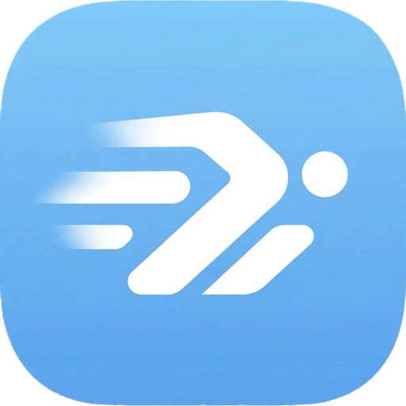
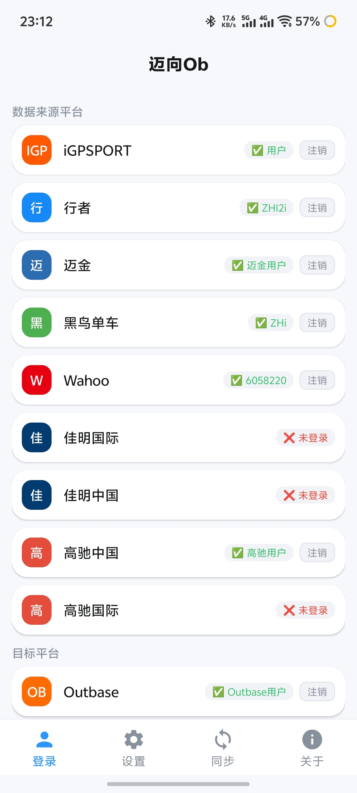
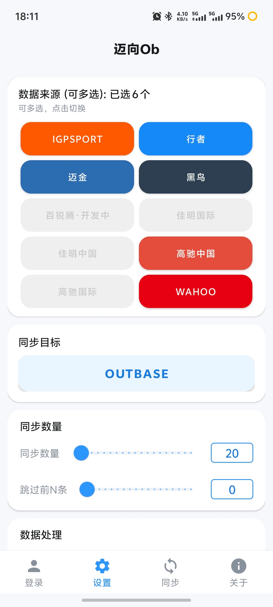
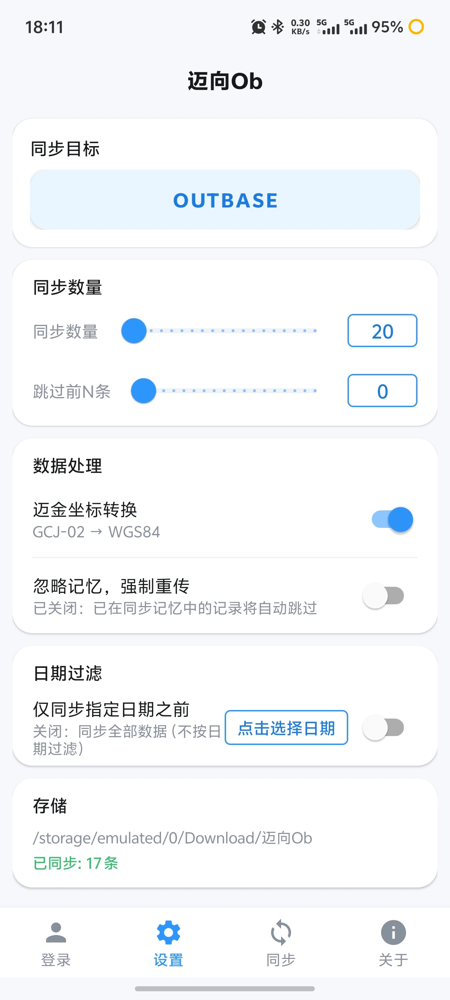
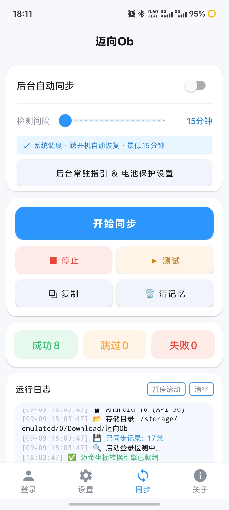
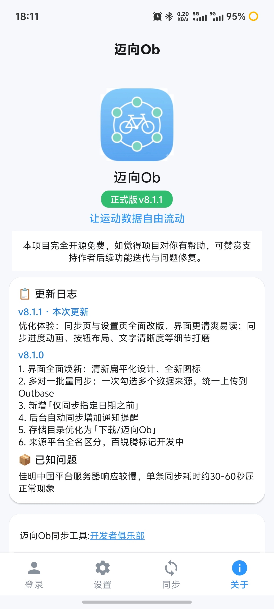

# 🚴 迈向Ob（正式版）

<p align="center"></p>

**多平台运动数据 → Outbase 一键迁移工具**

[](https://developer.android.com)
[](https://kotlinlang.org)
[](LICENSE)
[]()

一款 Android 运动数据迁移工具：**一次勾选多个数据源平台，统一批量上传到 Outbase**，解决骑行/跑步数据散落在多个平台、难以集中管理的痛点。

让运动数据自由流动 🚴♂️

> **正式版**：专注「多来源 → Outbase」单向链路，主打稳定，适合日常使用。
>
> **开发体验版**：支持平台间互传等更多新功能，目前正处于开放测试阶段，功能可能还不够稳定，还请大家多多担待。欢迎体验：[开发体验版](https://github.com/Anathleticbicyclist/sports-data-sync-multiplatform)

---

## ✨ 功能特性

### 核心功能（多对一 Outbase 上传）

- 🎯 **多对一上传** — 一次勾选多个数据来源平台，统一上传到 Outbase，每条记录自动去重
- ✅ **批量同步** — 支持 1~1000 条记录，可跳过前 N 条历史数据
- 🔄 **后台自动同步** — WorkManager 调度，系统级保活，跨开机自动恢复，可配置检测间隔，支持全部 25 个来源平台
- 📊 **同步任务详情** — 任务卡片「详情」弹窗：本次运行各平台下载/上传/失败明细、历史 5 次记录、累计统计
- 📋 **详细运行日志** — 全程记录，一键复制，失败原因分类
- 💾 **同步记忆** — 已上传记录自动记忆，不重复上传；支持"忽略记忆，强制重传"
- 📅 **仅同步指定日期之前** — 开启后只同步截止日期之前的历史数据，适合回溯旧记录
- 📂 **文件本地存储** — 同步的 FIT/GPX 文件自动保存至手机 `Download/迈向Ob/` 目录，支持一键打开目录查看
- 🧭 **迈金 GCJ-02 坐标转换** — 迈金两个下载通道独立开关：七牛云直链（绝大多数为 WGS-84，默认关）与 fit_content 接口（绝大多数为 GCJ-02，默认开），可分别控制是否转换
- ⏰ **开屏动画** — 1 秒清爽开屏，浅蓝渐变
- 🔁 **6 平台自动重登** — Keep/咕咚/MyWhoosh/Zwift/Zepp/Komoot 登录后记住账号密码，token 过期自动重登，App 重启后同样生效；注销时自动清除保存的密码
- 📊 **Outbase 登录卡升级** — 固定整行卡片：记录条数徽标 + ↑下载/↓跳过/✗失败统计行，点击查看完整同步详情弹窗
- 🔍 **检查更新** — 关于页一键检测正式版最新版本
- 🛡️ **上传结果确认** — Outbase 异步处理「待处理」不算成功，不写同步记忆、下次同步自动重试，杜绝假成功
- 🕐 **Keep 时间修复** — 修复 Keep 导入时间错乱（epoch 秒误判偏移约 20 天）
- 🗂️ **合并文件识别增强** — 手动选择 FIT/GPX 合并时按文件内容识别（FIT 头 / GPX XML），部分机型不再提示"未选择"

### 四页布局

| 页面 | 说明 |
|:----|:----|
| **登录** | 各平台登录卡片，独立登录互不影响，支持注销 |
| **设置** | 多选数据来源、同步数量、跳过前 N 条、仅同步指定日期之前、迈金坐标转换（七牛云 / fit_content 双开关）、忽略记忆开关 |
| **同步** | 开始/停止/测试下载、一键复制日志、清除同步记忆、后台自动同步开关 |
| **关于** | 版本信息、检查更新、更新日志、鸣谢、赞赏支持、俱乐部与仓库链接、开源软件免责声明 |

### 📱 界面预览

<p align="center">
  
  
  
  
  
</p>

---

## 🌐 支持平台

### 数据来源（可多选，下载数据）

| 平台 | 登录方式 | 数据格式 |
|:----|:--------|:--------|
| **iGPSPORT** | WebView 登录 / 短信验证码登录 | FIT |
| **行者** | WebView 登录 | GPX / FIT |
| **捷安特** | 账号密码登录 | FIT |
| **迈金/顽鹿OTM** | WebView 登录 | FIT |
| **黑鸟单车** | WebView 登录 | FIT |
| **百锐腾** | WebView 登录 | FIT / GPX（开发中） |
| **佳明国际** | WebView 登录 | FIT |
| **佳明中国** | WebView 登录 | FIT |
| **高驰中国** | WebView 登录 | FIT |
| **高驰国际** | WebView 登录 | FIT |
| **Wahoo** | OAuth2 登录 | FIT |
| **MyWhoosh** | 账号密码登录 | FIT |
| **Zwift** | 账号密码登录 | FIT |
| **Keep** | 账号密码登录 | GPX（自动转 FIT 上传） |
| **咕咚** | 手机号密码登录 | GPX（自动转 FIT 上传） |
| **Zepp** | 邮箱/手机号密码登录 | GPX（自动转 FIT 上传） |
| **Komoot** | 邮箱密码登录 | GPX（自动转 FIT 上传） |
| **松拓** | OAuth2 授权（需自行申请开发者凭证） | FIT |
| **两步路** | WebView 登录 | KML（浏览即捕获下载） |
| **悦跑圈** | 短信验证码登录 | GPX |

### 同步目标（固定）

| 平台 | 说明 |
|:----|:----|
| **Outbase** | 所有来源数据统一上传至 Outbase |

---

## 🚀 快速开始

1. **下载安装** — 从 [GitHub Releases](https://github.com/Anathleticbicyclist/sync-igpsport-magene-onelap-xingzhe-data-to-outbase/releases) 下载最新 APK 安装到 Android 设备
2. **登录数据源** — 登录页点击各平台卡片完成登录（需账号的平台按平台登录方式操作）
3. **登录 Outbase** — 登录页点击 Outbase 卡片完成登录
4. **选择数据来源** — 设置页多选要同步的数据源（已登录才可选）
5. **设置同步参数** — 调整同步数量、跳过前 N 条、坐标转换开关等
6. **开始同步** — 同步页点击「开始同步」，统一上传到 Outbase
7. **后台自动同步**（可选）— 开启自动同步并设置检测间隔，按指引完成后台保活设置

---

## ⚠️ 已知问题

| 问题 | 影响范围 | 说明 | 状态 |
|:----|:--------|:----|:----|
| **佳明中国服务器慢** | 佳明中国作为来源 | 佳明中国服务器端响应慢，单条下载/上传约 30~60 秒属正常现象 | 服务器端限制，功能正常 |
| **百锐腾下载开发中** | 百锐腾作为来源 | 百锐腾下载功能开发中，同步时会自动跳过 | 开发中 |
| **松拓需自填凭证** | 松拓作为来源 | 松拓官方要求开发者应用凭证（Client ID/Secret/Subscription Key），需在 apizone.suunto.com 自行申请后填写 | 平台限制 |
| **咕咚/Zepp/Komoot 为 GPX** | 作为来源 | 该三平台数据为 GPX 格式，上传 Outbase 时自动转换为 FIT，部分运动类型可能被归为骑行 | 已知问题 |
| **两步路仅本地捕获** | 两步路作为来源 | 两步路官方无公开下载接口，采用「浏览即捕获」模式：在 WebView 中浏览轨迹详情页自动保存 KML；需先在登录页进入两步路浏览轨迹 | 逆向方案 |
| **悦跑圈逆向接口** | 悦跑圈作为来源 | 悦跑圈轨迹下载为逆向接口，已在真机验证通过；接口若变动可能失效，会随版本修复 | 逆向方案，待长期观察 |

---

## 🛠️ 技术栈

- **语言**: Kotlin 2.2.0
- **最低 SDK**: Android 8.0 (API 26)
- **目标 SDK**: Android 16 (API 36)
- **构建工具**: Gradle 8.13 + AGP 8.13.0
- **网络**: OkHttp 4.12
- **协程**: Kotlinx Coroutines 1.7.3
- **后台任务**: WorkManager
- **UI**: Material Components

---

## 📁 项目结构

```
app/
├── build.gradle                  # 应用模块配置
└── src/main/
    ├── AndroidManifest.xml
    ├── assets/
    │   ├── bridge.html           # WebView 桥页面（GPX转FIT）
    │   ├── gpx2fit.js            # Outbase官方 GPX→FIT 转换库
    │   └── magene_fix.js         # 迈金 GCJ-02→WGS84 坐标修正
    ├── java/com/jichi/ob/
    │   ├── MainActivity.kt       # 主界面 + 多对一同步调度
    │   ├── SplashActivity.kt     # 1秒开屏动画
    │   ├── AutoSyncWorker.kt     # 后台自动同步（WorkManager）
    │   ├── api/                  # 各平台接口（下载）+ Outbase上传
    │   ├── ui/
    │   │   ├── LoginFragment.kt        # 页面1 登录
    │   │   ├── SyncSettingsFragment.kt # 页面2 设置
    │   │   ├── SyncFragment.kt         # 页面3 同步
    │   │   ├── AboutFragment.kt        # 页面4 关于
    │   │   └── LoginWebActivity.kt     # WebView 登录
    │   ├── model/Activity.kt     # 数据模型 + 平台能力声明
    │   └── util/                 # 凭证存储、日志、文件保存
    └── res/                      # 布局、配色、字符串、图标、赞赏码
```

---

## 🔧 构建（开发者）

### 环境要求

- **JDK 17**（完整JDK，含javac）
- **Android SDK**: platforms;android-36 + build-tools
- **Gradle 8.13**（项目自带 gradle wrapper）

### 构建步骤

```bash
# 1. 克隆仓库
git clone https://github.com/Anathleticbicyclist/sync-igpsport-magene-onelap-xingzhe-data-to-outbase.git
cd sync-igpsport-magene-onelap-xingzhe-data-to-outbase

# 2. 配置签名密钥 local.properties（不提交到 git）
# storeFile=../jichi-ob-dev.keystore
# storePassword=你的密钥库口令
# keyAlias=jichiobdev
# keyPassword=你的密钥口令

# 3. 构建
./gradlew assembleRelease

# 4. 产物位置
# app/build/outputs/apk/release/app-release.apk
```

### 注意事项

- ⚠️ 工程需放在**本地磁盘**编译，网络挂载文件系统（如 OSS/FUSE）不支持 Gradle 校验服务
- ⚠️ 首次构建需要下载依赖，已内置阿里云镜像（settings.gradle）
- ⚠️ `local.properties` 与密钥库文件已加入 `.gitignore`，切勿提交到仓库

---

## 📋 更新日志

### v9.7.0（2026-11-24）
- **多日轨迹合并重做**（对齐开发版 v9.6.9）：合并口径由「按 GPS 点列重算」改为「直取各段码表 session 原值」——里程/计时/爬升逐段取设备记录值，跨段"跳飞"距离不再计入总里程；按段（多日即按天）自动分圈，FIT 输出中 lap 的距离/计时直填源段原值；时间轴改用原始时间戳，不再压缩暂停间隔
- **启动登录检测防闪退**（对齐开发版 v9.6.8）：检测协程加异常兜底（异常只记日志不重抛），单平台自动重登请求独立 try/catch——平台失效 / 无网 / 不可达时不再循环闪退
- **自动重登优化**（对齐开发版 v9.6.7）：门槛由「已登录」改为「已登录或可自动重登」——token 过期但账号密码 / refresh token 仍在的 Keep、MyWhoosh、Zepp、Komoot、迈金、Wahoo 也会进入检测并可无感恢复；重登失败后 30 分钟冷却，避免无网时反复重试
- **坐标转换兼容性增强**：FIT 头部声明长度大于实际长度（下载被截断）时不再整份放弃，按实际长度尽力解析并补写尾部 CRC；解析越界 / 缺定义时立即停止而非盲跳字节，避免错位改坏数据
- **新图标**：蓝底白色「向前迈进」图形，与正式版 UI 主色统一
- **骑行台数据兼容**：支持迈金 / 顽鹿骑行台的室内记录——无 GPS 轨迹的 FIT 不再判「无轨迹」而整段丢弃，可正常合并、预览与上传 Outbase（室内记录优先取码表 session 原值计时 / 里程，不做点列重算）

### v9.6.6（2026-11-12）
- **修复迈金玩鹿运动OTM最新数据获取BUG**：同步拉列表前先调 capability_list 预导入（单轮 20 条窗口、最多追 3 轮、实例级幂等），新骑完的记录不再"看不到"；refreshToken 严格校验 code==200 并回写新令牌（服务端未下发时保留旧值）；只有 401 才刷新重登，403 风控单列不重试

### v9.4.0（2026-10-25）
- **新增深色模式三态开关**（对齐开发版 v9.2.9）：设置页新增「深色模式」入口，支持 **跟随系统 / 浅色 / 深色** 三种模式，全页面夜间适配（页面背景/卡片/文字/日志/平台徽章等颜色资源化 + values-night 深色配色，App 重启后保持）
- **UI 视觉精修**（对齐开发版 v9.2.8）：新增强调渐变与日志分层命名色（gradient/log_success/log_skip/log_normal/log_time）、关于页白卡与登录注销按钮圆角对齐、全部布局硬编码颜色转命名色资源（深色可读性基础）

---

## 📄 免责声明 / Disclaimer

**一、独立项目声明**
本应用是一款由个人开发者独立维护、完全开源的个人工具，与 OneLap、Strava、Intervals.icu、Outbase、iGPSPORT、行者、迈金、黑鸟单车、百锐腾、佳明、高驰、Wahoo 等所有在本项目中提及的平台及其官方主体均**无任何关联、合作、授权或背书关系**。本应用不以任何形式代表上述平台。各平台名称、商标、LOGO 均为其各自权利人的财产，仅用于标识用户数据来源，不构成任何关联或授权声明。

**二、使用风险自担**
本应用按"现状"（AS IS）提供，作者对其适用性、准确性、稳定性、完整性及不侵权性不作任何明示或默示的担保。用户自愿选择使用本应用，因使用、误用或依赖本应用（包括但不限于数据同步异常、数据丢失、账号异常、平台风控或第三方服务变更）所产生的一切直接或间接损失，均由用户自行承担，作者不承担任何责任。

**三、数据与隐私**
本应用**不向任何第三方或作者控制的服务器收集、存储或传输**用户个人数据。活动数据仅在用户**主动触发同步**时上传至用户指定的目标平台。所有平台账号凭证（含登录 Cookie、Token 等）仅保存在设备本地，不向任何服务器上传。

**四、合规使用**
用户应自行确保其使用方式符合各目标平台的服务条款、用户协议及所在国家或地区的法律法规。本应用仅用于用户对**自有数据**的迁移、备份与归集，不得用于商业用途、数据爬取、批量抓取或任何侵犯第三方权益的行为。因用户违规使用导致的账号封禁、数据删除或其他后果，作者不承担任何责任。

**五、开源与担保豁免**
本应用以 MIT 协议开源，用户可自由查看、修改与分发源码；开源授权不构成对本免责声明的豁免，亦不构成任何形式的担保。

---

**1. Independent Project Statement**
This app is a personal open-source tool maintained by an individual developer. It has **no affiliation, partnership, authorization or endorsement** from OneLap, Strava, Intervals.icu, Outbase, iGPSPORT, Xingzhe, Magene, Blackbird, Bryton, Garmin, COROS, Wahoo or any other platform mentioned in this project, nor their official entities. This app does not represent any of the above platforms. All platform names, trademarks and logos are the property of their respective owners and are used solely to identify data sources.

**2. Use at Your Own Risk**
The app is provided "AS IS" without warranties of any kind, express or implied, including but not limited to fitness, accuracy, stability, completeness or non-infringement. By using this app, you acknowledge that all direct or indirect losses arising from the use, misuse or reliance on this app (including but not limited to abnormal synchronization, data loss, account issues, platform risk control or third-party service changes) shall be borne by yourself. The author accepts no liability.

**3. Data & Privacy**
This app does **not** collect, store or transmit your personal data to any third party or author-controlled server. Activity data is only uploaded to your designated destination platform when you explicitly trigger a sync. All credentials (including cookies and tokens) are stored locally on your device only and are never uploaded to any server.

**4. Compliant Use**
You are solely responsible for ensuring that your use complies with the terms of service of each destination platform and the laws of your country or region. This app is intended solely for the migration, backup and aggregation of your **own data**. It must not be used for commercial purposes, data scraping, bulk crawling or any act that infringes the rights of third parties. The author accepts no liability for account bans, data loss or other consequences resulting from your non-compliant use.

**5. Open Source & Warranty Disclaimer**
This app is open-sourced under the MIT License. You are free to view, modify and distribute the source code. The open-source license neither waives this disclaimer nor constitutes any form of warranty.

---

## 📄 数据版权声明

各平台数据版权归原平台和该数据产生用户共同所有，本工具仅用于用户个人数据的迁移与备份，不得用于商业用途或数据爬取。

---

## 📄 许可证

本项目采用 [MIT License](LICENSE) 开源。

---

## 🙏 鸣谢

感谢以下平台为热爱运动的用户提供的数据记录与存储服务：

- iGPSPORT 迹驰 — 专业骑行码表与运动数据平台 [www.igpsport.com](https://www.igpsport.com/)
- 行者 — 运动记录与骑行社区平台 [www.imxingzhe.com](https://www.imxingzhe.com/)
- 迈金/顽鹿 — 智能骑行设备与数据平台 [www.magene.com](https://www.magene.com/)
- 黑鸟单车 — 骑行运动记录平台 [www.blackbird.com.cn](http://www.blackbird.com.cn/)
- 百锐腾 — 骑行码表与运动数据平台 [www.brytonsport.com](https://www.brytonsport.com/)
- 佳明 — 智能运动手表与生态平台 [www.garmin.com](https://www.garmin.com/)
- 高驰 — 户外运动手表与数据平台 [www.coros.com](https://www.coros.com/)
- Wahoo — 智能骑行设备与训练平台 [www.wahoofitness.com](https://www.wahoofitness.com/)
- MyWhoosh — 室内虚拟骑行平台 [www.mywhoosh.com](https://www.mywhoosh.com/)
- Zwift — 室内虚拟骑行与训练平台 [www.zwift.com](https://www.zwift.com/)
- Keep — 运动健身记录与社区平台 [www.gotokeep.com](https://www.gotokeep.com/)
- Outbase — 运动数据聚合平台 [outbase.cn](https://outbase.cn/)

感谢以下人员（均为骑行爱称）为软件测试提供的帮助：素甲粉、青岛AUV阿哲、清茶、萧、洪斌大哥、鸽子王腰果、rockozhao、胶州一哥大沽河河长赵铁柱、海参、兰兰大王、。。、初夏飞雪bab、心急吃不了热豆付、青山依旧张指导、阿泽阿

鸣谢青岛AUV俱乐部

感谢开源项目 [garth](https://github.com/matinaslight/garth)、[magene-fit-strava-fix](https://github.com/dwmer0308-a11y/magene-fit-strava-fix) 提供的佳明登录与迈金坐标修正算法参考。

---

## 📞 联系我们

如有问题或建议，欢迎加入 [Outbase 俱乐部](https://outbase.cn/zeusfit/zeusfit-mk/sharePage.html?_bid=1005477&type=club&clubId=MTAxMjgz&timestamp=1787569599904&sign=b4604ad9041551e64ce90ea385a0029f) 与主理人反馈。

**迈向Ob** — 让运动数据自由流动 🚴♂️
